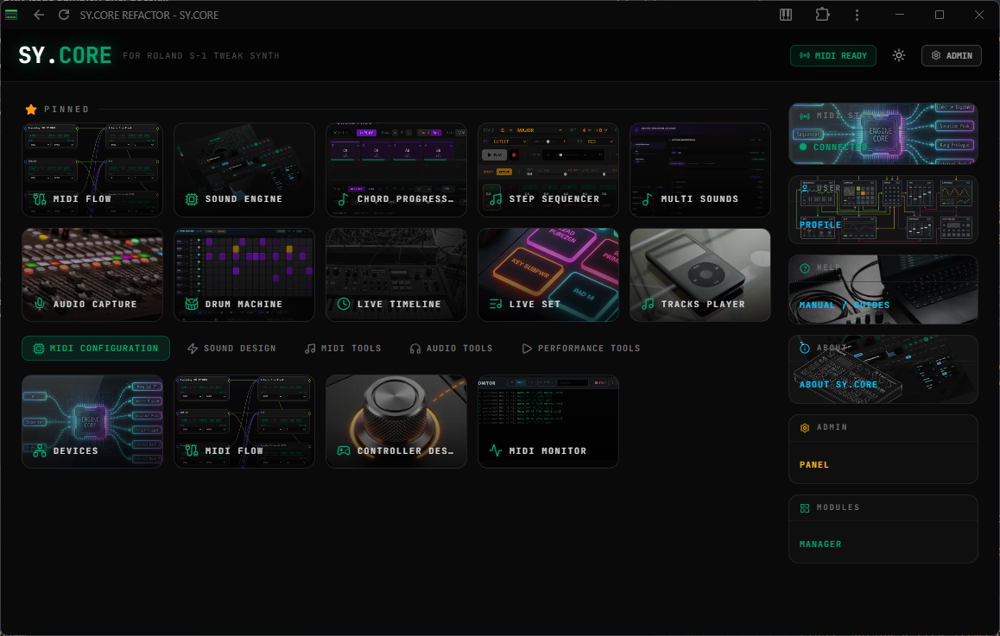

# SY.CORE



> Chords, patterns and grooves generated while you play — in the browser, in time with your hardware rig and with Ableton Live.

**[Open the app](https://sycoreapp.vercel.app)** · **[Website](https://sycore-website.vercel.app)** · **[Ableton Live devices](https://github.com/swina/sycore-ableton/releases/latest)** · [Changelog](./CHANGES.md)

SY.CORE is a local-first web app for electronic musicians: generative instruments (Chord Prog, Sequencer, Drum Machine, Arpeggiator), MIDI routing and mapping for a hardware rig, audio tools, and a performance layer driven from a Launchpad and a MIDImix. It runs in Chrome or Edge with no installation; with **SY.CORE Link** it plays inside an Ableton Live set, on Live's clock.

---

## Generate and play

The four generative apps share one idea: generate, launch and reshape the music while it plays — not prepare clips beforehand.

- **Chord Prog** — harmonic sequencer with 8 slots (A–H) chainable into an arrangement, chord library and suggestions, Chord / Arp per step, MIDI file import, Now / Next display. It drives the key of the other apps.
- **Sequencer** — 8 banks (A–H), up to 64 steps, chain of 16. **Generate** by Style (16 styles), Key / Scale, octaves, Density, Rhythm (Weighted / Euclid / Random) and Melody (Line: a motif and its variation / Classic); Chords and Arpeggio modes; **Vary** changes only part of the pattern (a Turing-machine lock). P1 / P2 per step, generated with RND% and regenerable on their own. Save one bank or all of them. See [Sequencer — Generate](./docs/guides/SYCORE_SEQUENCER_GENERATE.md).
- **Drum Machine** — 11 tracks × 16 steps, A–H banks, Fill, Repeater, style generation, Euclidean generator, Patterns DB, a bassline generator.
- **Arpeggiator** and **Note Latch** — independent MIDI apps, cabled in MIDI Flow.
- **Step Sequencer** — the earlier algorithmic sequencer, 8 pattern slots.

Every Generate is kept as a session take, so nothing it replaces is lost.

## Performance

- **Workspaces** — *Classic* (free panels) or *Performance*: a play view per app (banks, the pattern on one row, Now / Next), with EDIT one click away. See [Workspaces](./docs/guides/SYCORE_WORKSPACES.md).
- **Rig Controller** — one panel, rows Drum · Chord · Seq · Bass · Arp: Trigger sync, arming, Mute / Solo, Intensity, Density, Fill, GEN and Mutate during playback, sections, Seq Free, Latch. Mapped to a Launchpad Mini MK1 and an AKAI MIDImix, or any controller through MIDI Learn and templates.
- **Live Timeline**, **Live Set** pads, **Samples Machine** (24 synced loop pads), **Deck** with Solo Performance Sets (Program Change recall A–H).

## Ableton Live — SY.CORE Link

Four Max for Live devices ([sycore-ableton](https://github.com/swina/sycore-ableton), GPL-3.0, a zip from the latest release):

| Device | What it does |
| --- | --- |
| **SY.CORE Link** | The bridge (one per set): SY.CORE follows Live's clock, tempo and position; Play / Stop and tempo of Live from SY.CORE; MIDI ports played on Live's beat |
| **Link Receive** | On each track that plays a SY.CORE app, on its channel |
| **SY.CORE Rig** | The Rig Controller's Launchpad layout inside Live |
| **SY.CORE Map** | Live instruments' parameters on 16 slots (tables for Drift, Analog, Simpler, Racks), moved from SY.CORE — including the Sequencer's P1 / P2 on any track (1.8) |

Setup and recording in Live: [SY.CORE with Ableton Live](./docs/guides/SYCORE_ABLETON_LIVE_GUIDE.md) · for musicians: [SY.CORE for Ableton Live](./docs/guides/SYCORE_FOR_ABLETON_LIVE.md) ([italiano](./docs/guides/SYCORE_FOR_ABLETON_LIVE_IT.md)).

## MIDI tools

- **Devices** — hardware auto-discovery, Virtual Instruments bound to a real port.
- **MIDI Flow** — drag-and-drop routing canvas: device → app and app → app, note-range splits, channel filters, multi-channel fan-out, saved configurations; cables "via SY.CORE Link" to play a port on Live's beat.
- **Mapping**, **Actions**, **Controller Designer**, **Monitor**, **MIDI Capture** (piano roll, export).
- **Sync** — one global BPM for every app and the outgoing MIDI clock.
- **Program Change browser** — custom banks per device; imports from E-MU Emulator X3, MicroFreak, Pigments, SEQTrak, Bass Station, OsTirus and SQLite bank databases.

## Audio and sound

- **Sound Engine** — Roland S-1 preset generation and management, beyond the hardware's 64 slots.
- **Audio Capture**, **Audio Looper** *(beta)*, **Sampler** *(beta)*, **Backing Track Player**, **Freesound browser**.

## Platform

- **Module Manager** — turn off any app you don't use; it disappears from every toolbar and launcher.
- **Local-first** — sessions, banks and libraries live in IndexedDB / localStorage, saved as you go; nothing needs the network during a set.
- **In-app Guides** — the same pages as [`docs/guides/`](./docs/guides/INDEX.md), also on the website.

---

## Getting started

Requirements: **Node.js** 20.19+ or 22.12+, npm, and Chrome or Edge (Web MIDI).

```bash
git clone https://github.com/swina/sycore-refactor.git
cd sycore-refactor
npm install
npm run dev          # http://localhost:4100 (VITE_DEV_PORT to change it)
```

| Command | What it does |
| --- | --- |
| `npm run dev:refactor` | A second instance side by side: port 3999, its own IndexedDB (`sycore_2`) |
| `npm test` | Vitest unit and component tests |
| `npm run build` / `npm run preview` | Production build in `dist/` and its preview (use it for timing tests with Live) |
| `npm run deploy:app` | The app on Vercel |
| `npm run deploy:website` | The website (`website/`, built with `--mode website`) on Vercel |

Deploy details: [DEPLOY.md](./DEPLOY.md).

### Environment variables

| Variable | Description |
| --- | --- |
| `VITE_DEV_PORT` | Dev server port |
| `VITE_DB_NAME` | IndexedDB database name |
| `VITE_WEBSITE_URL` | The website link in the top bar |

---

## Tech stack

| Layer | Technology |
| --- | --- |
| UI | [Vue 3](https://vuejs.org/) (`<script setup>`), [Tailwind CSS](https://tailwindcss.com/), [Lucide](https://lucide.dev/) |
| Language | JavaScript and [TypeScript](https://www.typescriptlang.org/) |
| State | [Pinia](https://pinia.vuejs.org/), [vue-router](https://router.vuejs.org/) |
| Build / tests | [Vite](https://vitejs.dev/), [Vitest](https://vitest.dev/) + Vue Test Utils |
| Audio / timing | [Tone.js](https://tonejs.github.io/), Web Audio API |
| MIDI | Web MIDI API, [webmidi.js](https://webmidijs.org/) |
| Ableton Live | Max for Live + Node for Max bridge over WebSocket ([protocol](https://github.com/swina/sycore-ableton/blob/main/docs/link-protocol-v1.md)) |
| Persistence | IndexedDB, localStorage, [sql.js](https://sql.js.org/) for bank imports |
| PWA / backend | [vite-plugin-pwa](https://vite-pwa-org.netlify.app/); Vercel functions + Upstash Redis for Web Push |

## Architecture

```
UI (Vue panels, play views, workspaces)
  │  read / write
Stores (Pinia: MIDI, UI, Chord Prog, Sequencer, Drum, Live Map, Rig…)
  │
Engines (src/core/engines: chord-prog, sequencer, drum… — run with their panel closed)
  │  notes / CC                      │  clock, tempo, map
Web MIDI ports                    SY.CORE Link (WebSocket) → Ableton Live
  │
Persistence (IndexedDB, localStorage)
```

- Engines are independent of their panels: the Rig Controller and Live drive them with the panels closed.
- Cross-app messages go through window events (`seq-generate`, `seq-bank-cue`, …) rather than shared component state.
- Panels are lazy-loaded; every change is persisted as it happens.

---

## Documentation

- [Guides index](./docs/guides/INDEX.md) — every app, MIDI tool and the Ableton Live setup
- [Manifesto](./docs/MANIFESTO.md) — why SY.CORE exists
- [CHANGES.md](./CHANGES.md) — what changed, newest first

## License

MIT. The Ableton Live devices ([sycore-ableton](https://github.com/swina/sycore-ableton)) are GPL-3.0.
